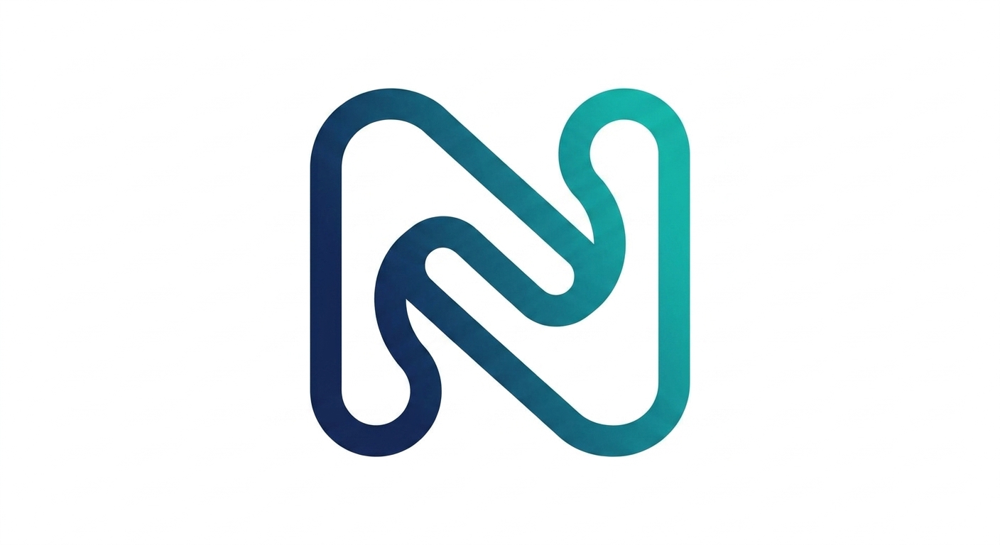
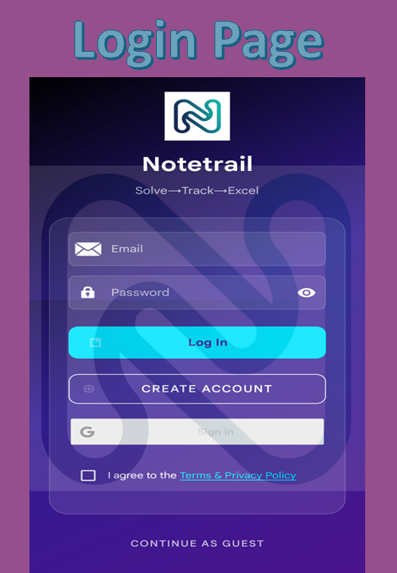
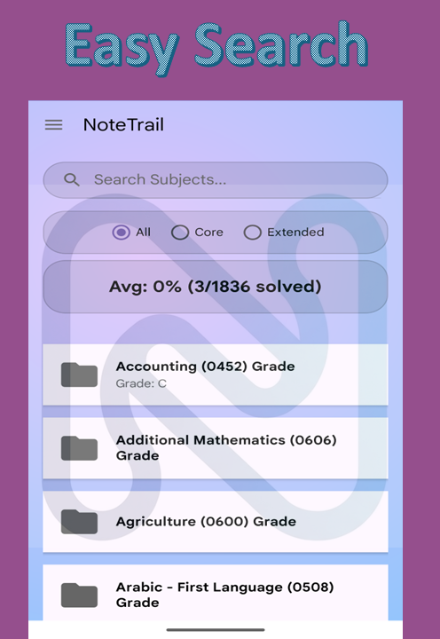
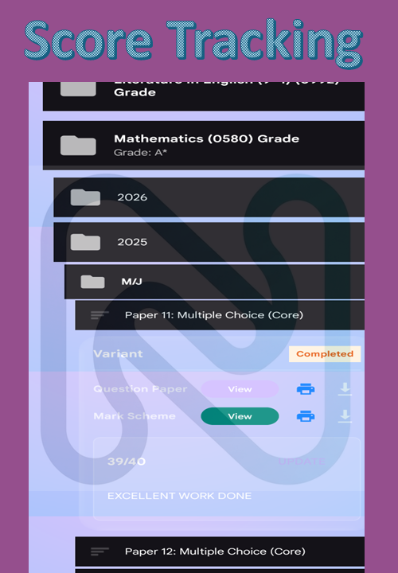
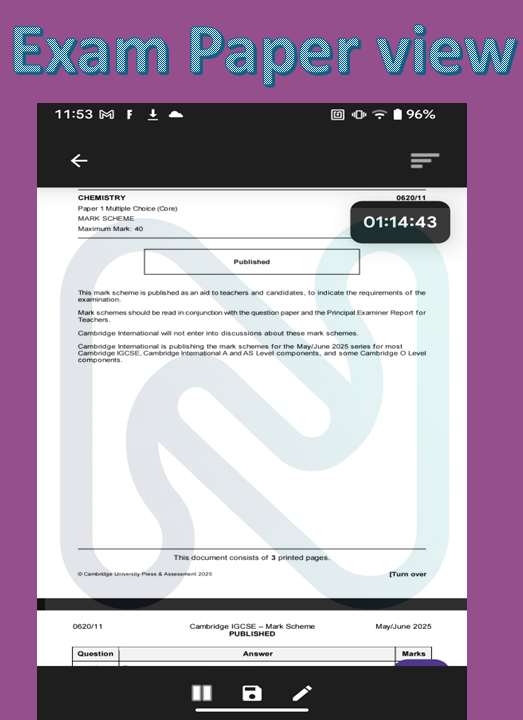
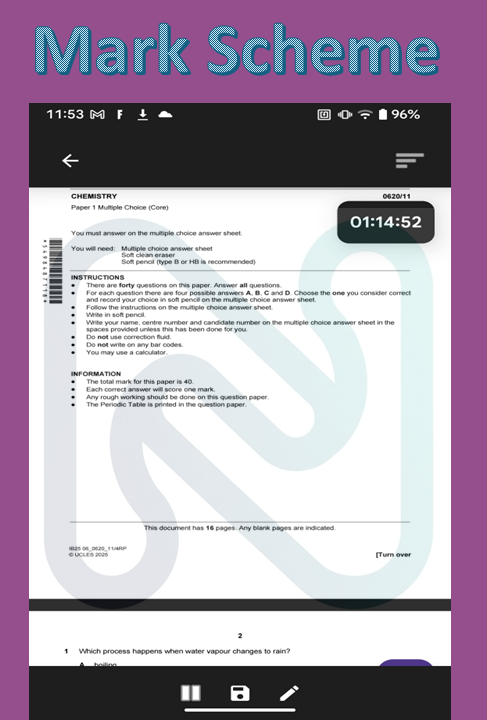
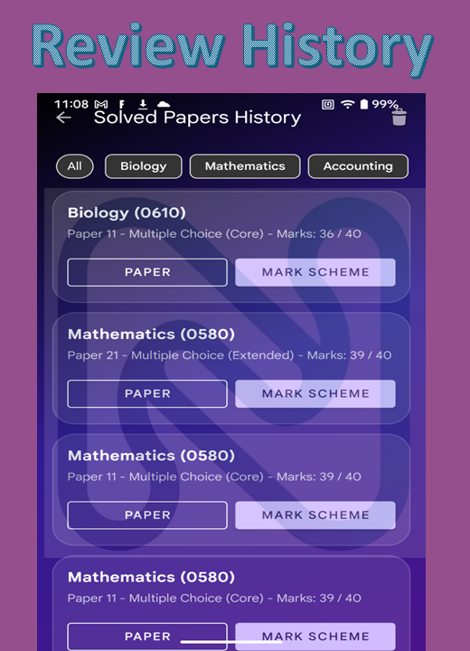
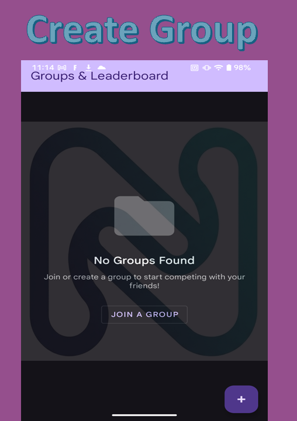

<p align="center">
  
</p>

<h1 align="center">NoteTrail</h1>
<p align="center"><b>Solve → Track → Excel</b></p>
<p align="center">
  A native Android app that helps students practise past papers, track every score,<br>
  and see exactly where to focus before exams.
</p>

<p align="center">
  
  
  
  
  
</p>

---

## Why NoteTrail?

Most students prepare for board exams with no clear picture of progress. Marks live in notebooks,
flat averages hide how much each paper really counts, and weak subjects get noticed too late.

NoteTrail turns raw scores into a clear roadmap: which papers you've solved, how you did, how each
component weighs into your final grade, and what you need on the next paper to hit your target.

> Package: `com.mechanicalaxiom.notetrail` · Currently in **Google Play Closed Testing**

## Screenshots

| Login | Subjects & search | Score tracking |
|---|---|---|
|  |  |  |

| Paper view | Timed solving | Review history | Groups & leaderboard |
|---|---|---|---|
|  |  |  |  |

## Features

- **Subject → year → session → paper hierarchy**: Browse papers across IGCSE subjects with exam year navigation (2020–2026), session filters, search, and Core/Extended paper filters.
- **Score tracking & notes**: Record marks obtained vs total marks per paper, completion status, timestamped logs, and personal encrypted notes.
- **In-app paper & mark-scheme viewer**: Built-in PDF viewer (`NoteTrailPdfViewerFragment`) featuring interactive canvas annotations (`AnnotationView`), color spectrum picker, thickness wheel, drawing shapes, eraser, running paper timer, and print/export tools.
- **Weighted grade analytics**: Custom Compose `Canvas` rendering for a weighted average progress ring and subject performance breakdown cards (e.g. Theory 50%, MCQ 30%, Practical 20%).
- **Performance trajectory line chart**: Custom-drawn Compose line chart with dynamic Y-axis scaling to visualize score momentum, plateaus, and dips.
- **Target predictor**: Interactive goal grade slider that calculates the exact required average mark on upcoming papers with real-time feasibility warnings.
- **Review history log**: Filterable log of solved papers with score editing, notes review, and instant paper relaunch.
- **Groups & competitive leaderboards**: Create or join public/PIN-protected groups, track member ranks, earn dynamic badges (👑 Scholar, 🔥 Grinder, ⭐ A* Club), and view subject/paper comparison matrices.
- **Hardware-backed encryption & vault backup**: Client-side AES-256 encryption using Android Keystore (`CryptoManager`) with password-derived PBKDF2 vault backup and restore in Cloud Firestore (`RecoveryManager`).
- **Remote configuration & kill switch**: Remote content configuration via `LinkProtector` and maintenance mode lockout via `AppSecurity`.
- **Firebase Auth & Session Security**: Email/Password authentication, email verification enforcement, Google Sign-In, dark-mode-ready Material 3 UI, and multi-tier session wipe (`SessionManager`).

## Tech stack & architecture

| Area | Choice |
|---|---|
| Language / UI | Kotlin, Jetpack Compose, Material 3 |
| Auth | Firebase Authentication (email/password + Google Sign-In) |
| Database | Cloud Firestore, hierarchical per-user data under `users/{uid}` with real-time snapshot listeners |
| Encryption | Android Keystore (AES-256-GCM / AES-256-SIV) + PBKDF2 Cloud Vault Recovery |
| Charts | Custom drawing on Compose `Canvas` (no third-party chart library) |
| Distribution | Google Play App Signing; closed testing track |

### Architecture & Data Flow

NoteTrail follows a clean Android architecture combining MVVM UI patterns with domain analytics engines and client-side payload encryption:

```
[ Activities / Compose Screens ]
       │
       ├──> [ ViewModels / Data Holders ] (GroupViewModel, SettingsViewModel, IgcseDataHolder)
       │         │
       │         ├──> [ Domain Engines ] (GradeAnalyticsEngine, CryptoManager, RecoveryManager)
       │         │
       │         └──> [ Remote & Persistence ] (Cloud Firestore, Firebase Auth, Remote Config, Keystore)
```

- **Screens & Core Activities**:
  - `SplashActivity`: App entry gate checking Firebase Remote Config kill-switch (`AppSecurity`) and user session status.
  - `LoginActivity` & `EmailVerificationActivity`: Authentication flow supporting Email/Password sign-in, registration, email verification enforcement, and Google Sign-In (`GoogleIdTokenCredential`).
  - `MainActivity`: Core navigation screen managing subject catalogues, exam year selection (2020–2026), live search, paper filters (All, Core, Extended), score entry dialogs, drawer menu, and viewer launching.
  - `PdfViewerActivity` / `DocumentViewerActivity` / `NoteTrailPdfViewerFragment`: PDF reader using AndroidX PDF Viewer integrated with an overlay annotation canvas (`AnnotationView`), color picker, thickness wheel, paper timer, and print manager.
  - `AnalyticsActivity`: Jetpack Compose Material 3 performance screen containing the progress ring, trajectory chart, subject breakdown, and target predictor.
  - `HistoryActivity`: Historical log of solved papers filterable by subject with note editing and relaunch capabilities.
  - `GroupActivity`: Group dashboard featuring real-time member leaderboards, rank badge assignments, PIN protection, daily goals, and paper comparison matrices.
  - `SettingsActivity`: Customization panel for dark mode toggles, hardware encryption diagnostics, PBKDF2 vault backup/recovery, and session wiping.
  - `KillSwitchActivity`: Maintenance screen shown when the app is temporarily disabled via Remote Config.

- **ViewModels & Business Logic**:
  - `GroupViewModel`: Coroutine-driven LiveData state machine handling group management, parallel member data fetch, leaderboard rankings, and paper/subject average comparison logic.
  - `SettingsViewModel`: State management for app preferences and dark mode themes.
  - `GradeRepository` & `GradeAnalyticsEngine`: Domain analytics calculating running weighted averages based on paper component weights, trend velocity, and predictor targets.
  - `CryptoManager` & `RecoveryManager`: Client-side payload encryption using Android Keystore keys with password-derived PBKDF2 vault key backup and restoration in Firestore.
  - `SessionManager`: Comprehensive logout utility clearing memory state, SharedPreferences, encryption keys, local cache, and saved annotated papers.

- **Cloud Firestore Schema**:
  - `users/{uid}`: User profile document (`email`, `name`, `groupIds`, `encryptedGroupIds`, `lastActive`).
    - `users/{uid}/progress/data`: Document mapping paper keys (`{subject}_{session}_{year}_qp_{variant}`) to encrypted score payloads (`encryptedMeta`, `isCompleted`, `marksObtained`, `totalMarks`, `notes`, `timestamp`).
    - `users/{uid}/grades/{gradeId}`: Collection of grade records (`encryptedMeta`, `timestamp`).
    - `users/{uid}/security/cloud_vault`: Security vault document storing the PBKDF2-encrypted cloud master key (`encryptedVaultKey`).
  - `groups/{groupId}`: Group configuration document (`name`, `ownerId`, `pin`, `isPrivate`, `dailyGoal`).
    - `groups/{groupId}/members/{uid}`: Subcollection tracking member UIDs.

## Getting started

### Install the APK
Download the latest `.apk` from the [Releases](../../releases) page and install it on an Android device
(you may need to allow "Install unknown apps" for your browser/file manager).

### Build from source
1. Clone the repo and open it in **Android Studio** (latest stable).
2. Create your own Firebase project and add an Android app with package `com.mechanicalaxiom.notetrail`
   (or change the `applicationId` to your own).
3. Enable **Email/Password** and **Google** sign-in, and create a Firestore database.
4. Download your `google-services.json` and place it in `app/`. This file is git-ignored and is not in the repo.
5. Add your debug SHA-1 to the Firebase Android app (needed for Google Sign-In):
   `./gradlew signingReport`
6. Run the `app` configuration.

## Roadmap

- [ ] Public Google Play release
- [ ] Offline caching and offline score sync
- [ ] Custom paper bookmarking & tag manager

## Built with AI assistance

I designed NoteTrail's concept, data model and feature set, and built and shipped it myself.
I used AI tools (including Google Gemini in Android Studio) as a coding assistant, particularly in
the early stages, and I review, test and take responsibility for everything in this repository.

## Legal & disclaimer

- NoteTrail is an independent student project and is **not affiliated with or endorsed by Cambridge University Press & Assessment** or any exam board.
- Past papers and mark schemes are © their respective owners. This repository does **not** contain or redistribute exam papers.
- Source code is released under the [MIT License](LICENSE).
- ## Known limitations
- Note encryption currently uses a static test key. Replacing it with the per-device
  key is the next planned change.
- Papers are fetched from a private content server; this repo does not include them.
# Notetrail
